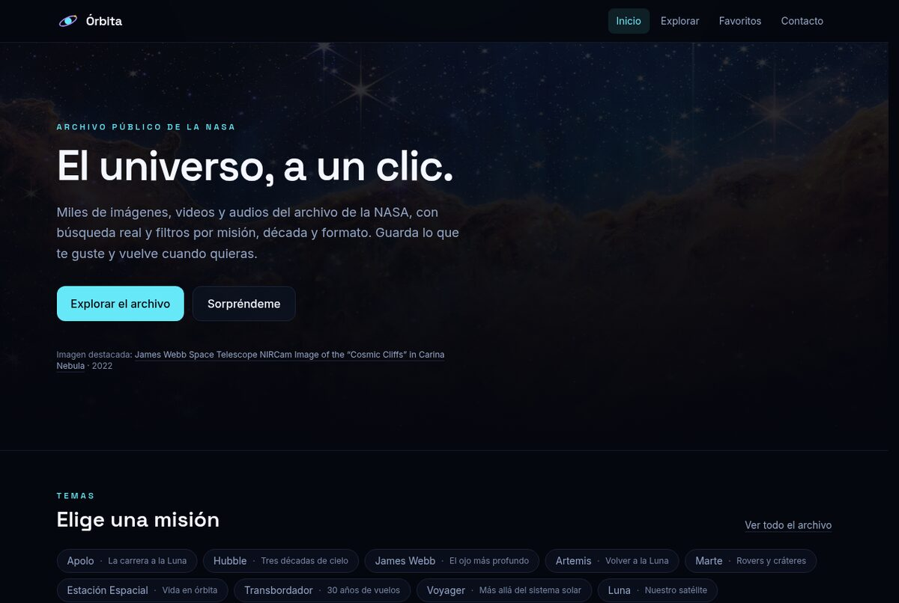

# Órbita — Explorador del archivo de la NASA

SPA hecha con **Vite + React + TypeScript** que explora el archivo público de imágenes, videos y audios de la NASA: búsqueda real contra la API, filtros por misión/década/formato, favoritos persistentes y las vistas de la consigna.

> Proyecto individual del curso. Los datos **no** están hardcodeados: todo se pide a `images-api.nasa.gov` en tiempo de ejecución.

## Capturas

| Inicio | Explorar |
| --- | --- |
|  |  |

| Detalle | Favoritos |
| --- | --- |
|  |  |


## Cómo correrlo

```bash
npm install
npm run dev      # http://localhost:5173
npm run build    # typecheck + build de producción
npm run preview  # sirve dist/
npm run lint     # oxlint
```

No hace falta ninguna API key ni archivo `.env`.

## Rutas

| Ruta | Vista | Qué hace |
| --- | --- | --- |
| `/` | Inicio | Hero con imagen destacada (fetch por ID) + franja del archivo (fetch de lista), temas y CTA |
| `/explorar` | Exploración | Grid de tarjetas, búsqueda con debounce, filtros por tema, década y formato, paginación "Cargar más" |
| `/explorar/:id` | Detalle | Fetch individual por ID (`nasa_id`), imagen, crédito, metadatos, palabras clave y favoritos |
| `/favoritos` | Favoritos | Colección guardada, quitar con confirmación, vaciar con dark pattern |
| `/contacto` | Contacto | Formulario controlado con validación, envío disabled y confirmación |
| `*` | 404 | Página no encontrada |

## Requisitos de la consigna

| Requisito | Dónde está |
| --- | --- |
| Vite + React + TypeScript | `vite.config.ts`, `tsconfig.app.json`, `src/*.tsx` |
| React Router con rutas | `src/App.tsx` (6 rutas, incluye `useParams` y 404) |
| Dos fetches (lista y detalle por ID) | `searchItems()` y `getItemById()` en `src/api/nasa.ts`; una en `/explorar`, otra en `/explorar/:id` |
| Loading / Error / Empty visibles | `LoadingState`, `ErrorState`, `EmptyState` + estados en `ExplorePage`, `DetailPage`, `HomePage`, `FavoritesPage` |
| Búsqueda y filtrado en tiempo real | `useDebouncedValue` + params `q`, `keywords`, `year_start`/`year_end`, `media_type` de la API |
| Favoritos en estado y entre rutas | `FavoritesContext` (arriba de las rutas) + `localStorage` |
| Formulario controlado con validación | `src/pages/ContactPage.tsx` (nombre, email, mensaje; botón disabled) |
| Toasts éxito / error / info con auto-dismiss | `ToastContext` + `Toast` (4,2 s, cierre manual) |
| Modal con `<dialog>` nativo + `useRef` + `showModal()` | `ConfirmDialog` y `DarkPatternDialog` |
| Dark pattern intencional + comentario | `src/components/DarkPatternDialog.tsx` (confirmshaming, opción destructiva preseleccionada, jerarquía asimétrica) |
| Tailwind CSS responsive | `src/index.css` + prefijos `sm:` `md:` `lg:` `xl:` |
| Accesibilidad | `alt`, `role`, `aria-label`, `aria-pressed`, `aria-live`, `aria-invalid`, `htmlFor`, HTML semántico (`header`, `nav`, `main`, `article`, `figure`/`figcaption`, `dl`, `ol`/`ul`, `dialog`), skip link y foco gestionado en diálogos |
| Mínimo 8 componentes `.tsx` separados | 12 en `src/components/` (+ 6 páginas) |

## La API

`https://images-api.nasa.gov` — NASA Image and Video Library. Pública, gratuita, **sin API key** y con CORS abierto.

- Lista/búsqueda: `GET /search?q=...&media_type=image&page=1&page_size=24`
- Detalle por ID: `GET /search?nasa_id=PIA14417`
- Formatos: `image`, `video`, `audio` (el hero y la grilla usan fotos por defecto porque los audios no tienen miniatura).
- Límites conocidos: **10.000 resultados máximo por búsqueda** (la app lo avisa y acota "Cargar más"); no hay parámetro de orden, así que el orden lo decide la API y el tiempo se filtra por año.
- La descripción y los créditos llegan con HTML: se limpian en `toPlainText()` antes de renderizar (nunca `dangerouslySetInnerHTML`).

## Estructura

```
src/
  api/nasa.ts            # contrato NasaItem + searchItems / getItemById / getRandomItem
  components/            # Layout, SearchBar, FilterBar, ImageCard, ImageGrid,
                         # FavoriteButton, Loading/Error/Empty, Toast, dialogs
  context/               # FavoritesContext, ToastContext
  data/filters.ts        # temas, décadas, etiquetas de centros
  hooks/                 # useDebouncedValue, useDocumentTitle
  pages/                 # Home, Explore, Detail, Favorites, Contact, NotFound
```

La UI solo habla con `src/api/nasa.ts`: si más adelante migramos a una API propia (por ejemplo para proxear imágenes y calcular paletas de color), se cambia ese archivo y nada más.

## Despliegue en Vercel

1. Subir el repo a GitHub.
2. Importar el repo en Vercel. Framework preset: **Vite** (build `npm run build`, output `dist`).
3. `vercel.json` ya reescribe todas las rutas a `index.html` para que los deep links (`/explorar/PIA14417`) no den 404.

## Notas y límites

- El formulario de contacto **no envía datos**: valida, confirma y muestra el toast, pero no hay backend.
- Los textos descriptivos vienen en inglés desde la NASA; la interfaz está en español.
- El filtro por color quedó fuera a propósito: el CDN de imágenes no expone CORS para leer píxeles, así que requiere un proxy propio.
- Créditos de las imágenes: NASA y sus autores, según el campo `credit` de cada pieza. Sin afiliación con la NASA.
