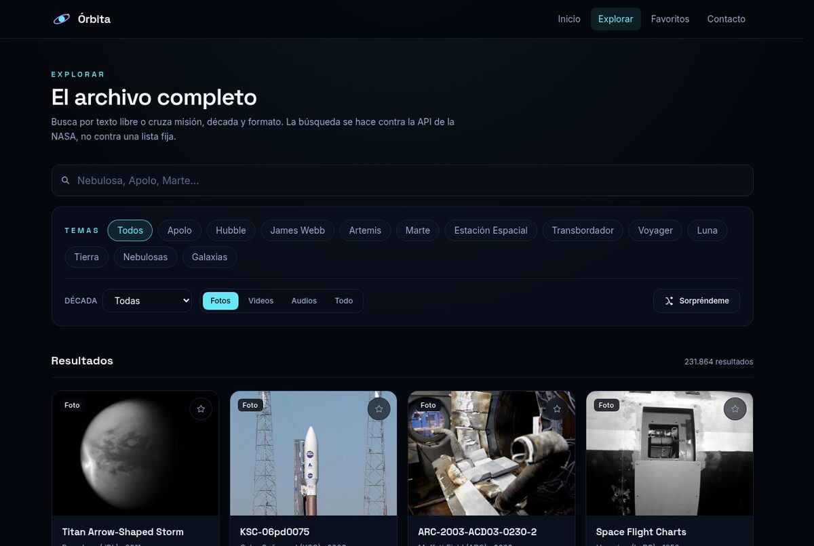
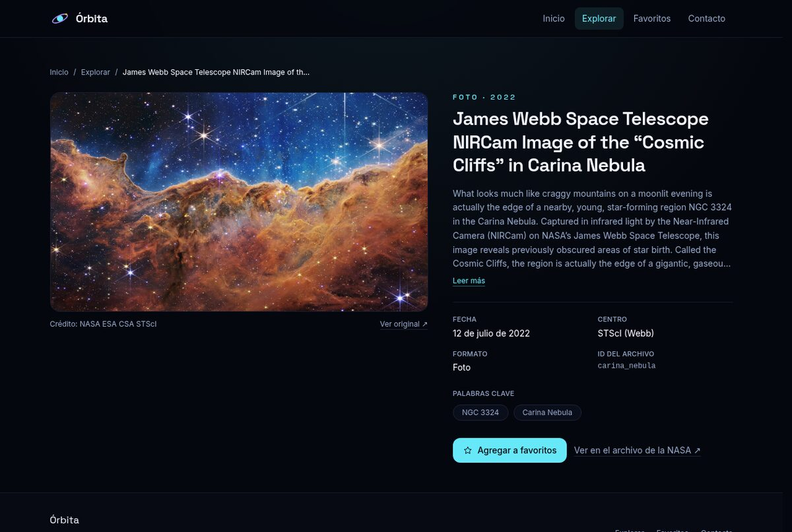
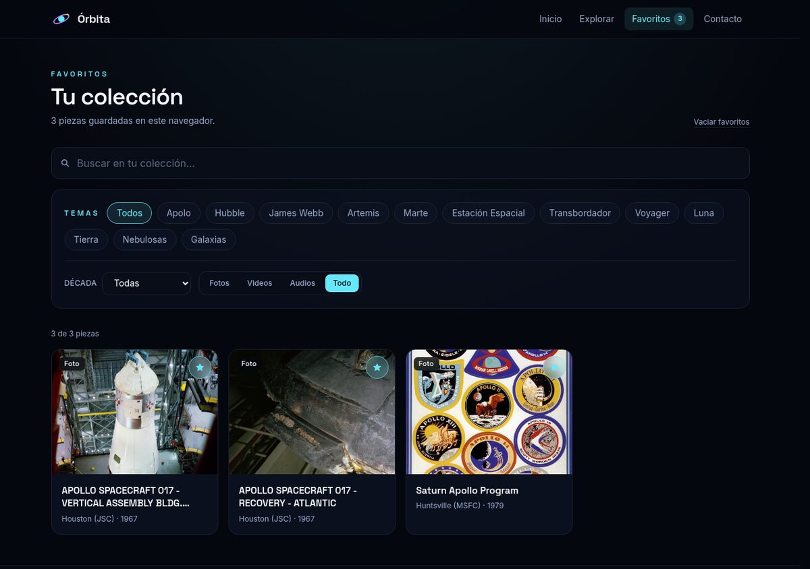
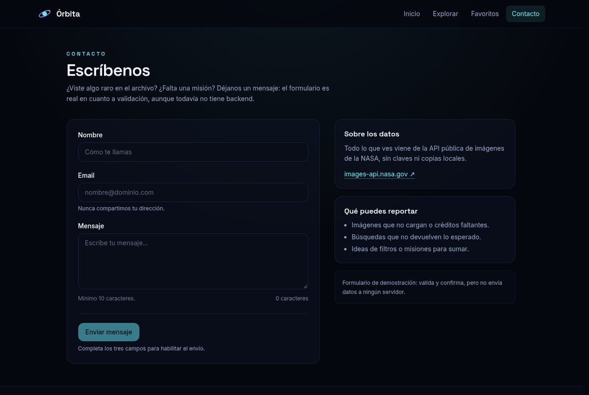

# Órbita

Una SPA para explorar el archivo público de imágenes, videos y audios de la NASA. Vite + React + TypeScript, React Router para las vistas y Tailwind para los estilos. Los datos salen de `images-api.nasa.gov`, sin API key.

Las vistas son inicio, explorador (búsqueda y filtros por misión, década y formato), detalle, favoritos y contacto. El detalle reproduce audios y videos; los favoritos quedan guardados en el navegador; el formulario de contacto valida pero no envía nada, porque no hay backend.

## Capturas

| Explorar | Detalle |
| --- | --- |
|  |  |

| Favoritos | Contacto |
| --- | --- |
|  |  |

## Notas

- La API devuelve hasta 10.000 resultados por búsqueda; al llegar al tope, la app lo indica en vez de seguir cargando.
- Las descripciones y los créditos vienen en inglés desde la NASA.
